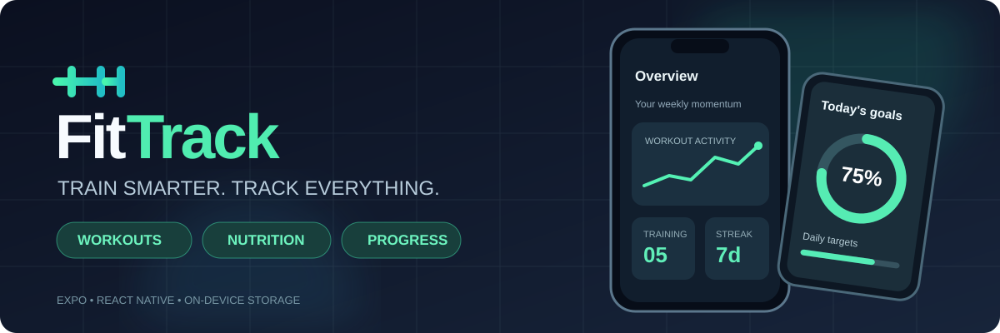
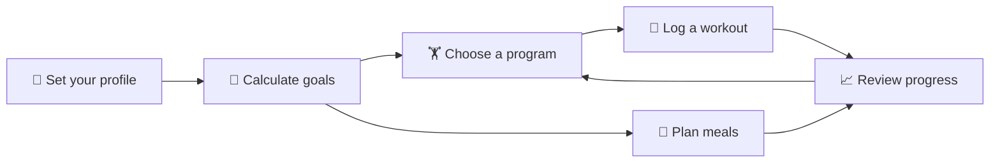

<div align="center">



<br/>

**Your training. Your nutrition. Your progress. One place.**

A mobile fitness companion that turns your goals into actionable workout plans, tailored nutrition guidance, and measurable progress.

[](https://expo.dev/)
[](https://reactnative.dev/)
[](https://developer.mozilla.org/en-US/docs/Web/JavaScript)
[](#getting-started)

<br/>

[**📲 Download Android APK**](https://github.com/Fadi7AY/Workout/releases) · [**🚀 Quick start**](#getting-started) · [**✨ Features**](#features) · [**🧩 Architecture**](#project-structure)

</div>

---

## ✨ Features

<table>
<tr>
<td width="50%" valign="top">

### 🏠 Your fitness dashboard
See your target-weight journey, key metrics, today's nutrition and your upcoming workout at a glance.

</td>
<td width="50%" valign="top">

### 🏋️ Training plans that fit
Choose from **5 programs**, from Beginner Full Body and Push/Pull/Legs to Upper/Lower, Fat-Burn Circuit and at-home workouts.

</td>
</tr>
<tr>
<td valign="top">

### 💪 Exercise library & workout log
Explore **35 exercises**, filter by muscle group, follow step-by-step coaching cues, and record sets, reps and weights with previous-weight reference.

</td>
<td valign="top">

### 🥗 Nutrition made practical
Generate daily meal plans around your calorie target, shuffle for variety and choose from **6 diet styles**, including high-protein, Mediterranean, vegetarian and vegan.

</td>
</tr>
<tr>
<td valign="top">

### 📈 Progress you can see
Follow weight and body-fat trends, review measurement history, check personal records and track workout volume.

</td>
<td valign="top">

### 🎯 Goals backed by calculations
Use your profile to estimate BMI, lean mass, BMR, TDEE, calories, macros, hydration and your goal timeline.

</td>
</tr>
</table>

## 📱 A day with FitTrack



> **Designed for everyday consistency:** get a clear plan, log the work, then use your history to see how far you've come.

## 🧠 Personalized fitness calculations

| Metric | How FitTrack approaches it |
| :--- | :--- |
| **Body composition** | BMI, estimated lean mass, and body-fat category |
| **Basal metabolic rate** | Katch–McArdle when body-fat % is supplied; otherwise Mifflin–St Jeor |
| **Daily energy** | Estimated maintenance calories (TDEE) based on activity |
| **Goal planning** | Daily calorie target and estimated weeks to target weight |
| **Daily targets** | Suggested macros and water intake |

These values are estimates and should be adjusted to real-world progress and individual needs.

## 📦 Getting started

### Option A — Install the Android APK

<div align="center">

[](https://github.com/Fadi7AY/Workout/releases/latest)

</div>

1. Open [**Releases**](https://github.com/Fadi7AY/Workout/releases) on your Android phone.
2. Download **FitTrack.apk** from the latest release, if an APK is attached.
3. Open the APK and follow Android's installation prompts. You may need to allow installation from your browser or file manager.

> **Build automation:** the repository includes a [Build Android APK workflow](.github/workflows/android-apk.yml) that runs on pushes to `main`. You can also start it manually from **Actions → Build Android APK → Run workflow**. Release availability depends on a successful build.

### Option B — Run from source

**Requirements:** Node.js, npm, and Expo Go or a configured Android/iOS simulator.

```bash
git clone https://github.com/Fadi7AY/Workout.git
cd Workout
npm install
npx expo start
```

Scan the development QR code with **Expo Go** on a compatible device, or press `a` in the terminal to launch an Android emulator. Native builds may be needed when Expo Go does not support the project's SDK or dependencies.

## 🛠️ Built with

<div align="center">


</div>

## 🧩 Project structure

```text
Workout/
├── src/
│   ├── app/
│   │   ├── (tabs)/          # Home, Workouts, Progress, Diet, Profile
│   │   ├── exercise/[id].js # Exercise details
│   │   └── log-workout.js   # Workout logging
│   ├── components/
│   │   └── ui.js            # Shared UI and SVG chart
│   ├── data/                # Exercises, programs, meals
│   └── lib/                 # Fitness calculations and persistent store
├── assets/                  # Icons and README artwork
├── .github/workflows/
│   └── android-apk.yml     # Android build automation
├── app.json                 # Expo app configuration
└── package.json
```

### 🔒 Storage & privacy

FitTrack stores app data **locally on your device using AsyncStorage**. This project does not describe a cloud synchronization or account-backup feature.

## 🤝 Contributing

Suggestions and improvements are welcome. [Open an issue](https://github.com/Fadi7AY/Workout/issues) to discuss a bug or feature, or submit a pull request with a focused change.

## 📄 License

See the [LICENSE](LICENSE) file for the repository's license terms.

---

<div align="center">

### 💚 Every rep counts. Every day adds up.

Built by [**Fadi7AY**](https://github.com/Fadi7AY) · [⭐ Star FitTrack on GitHub](https://github.com/Fadi7AY/Workout)

<sub>FitTrack provides general fitness and nutrition guidance, not medical advice.</sub>

</div>
